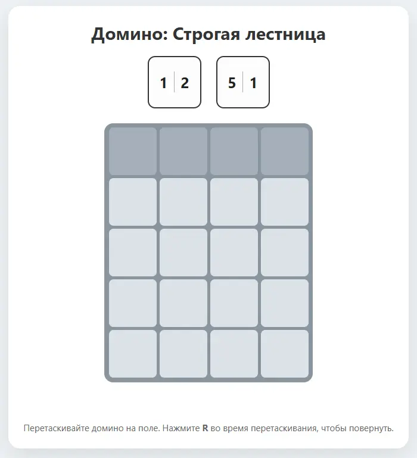
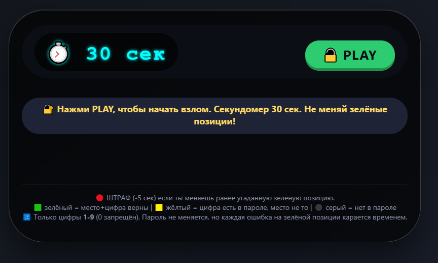
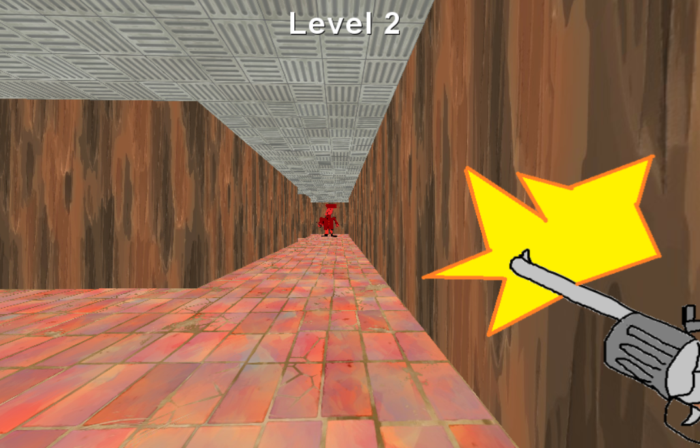
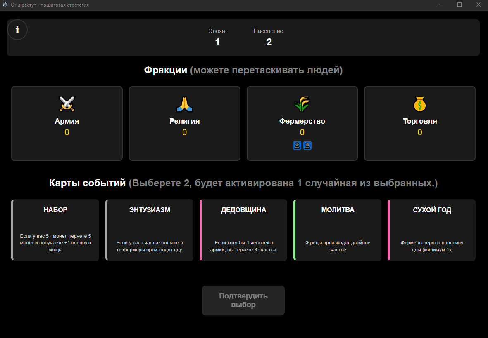
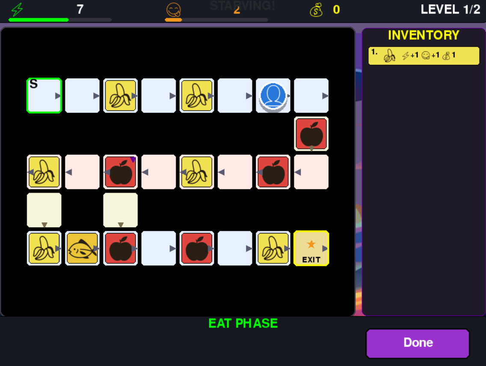
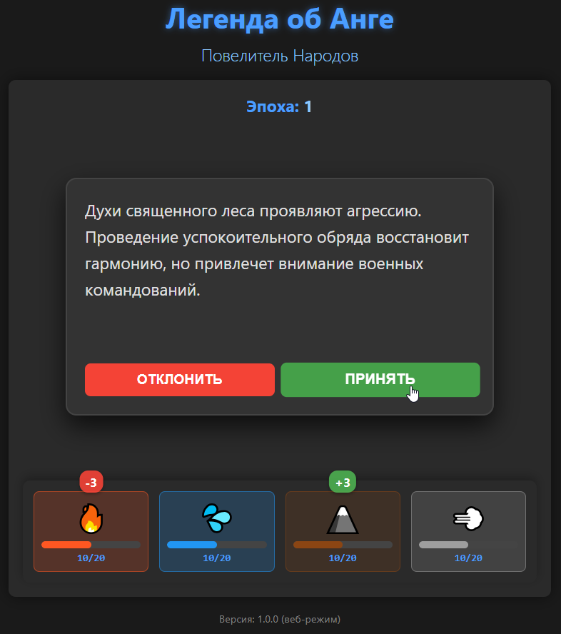
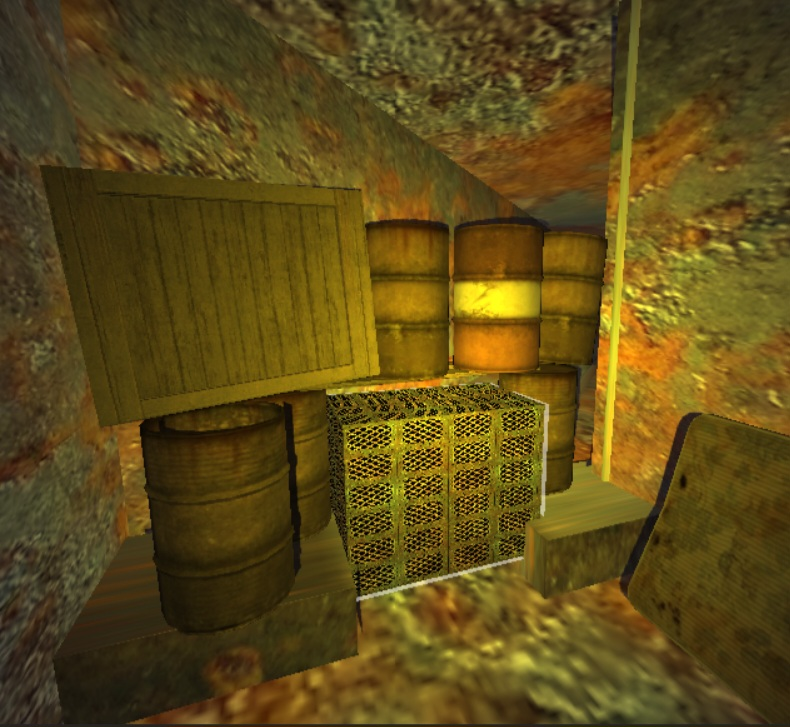
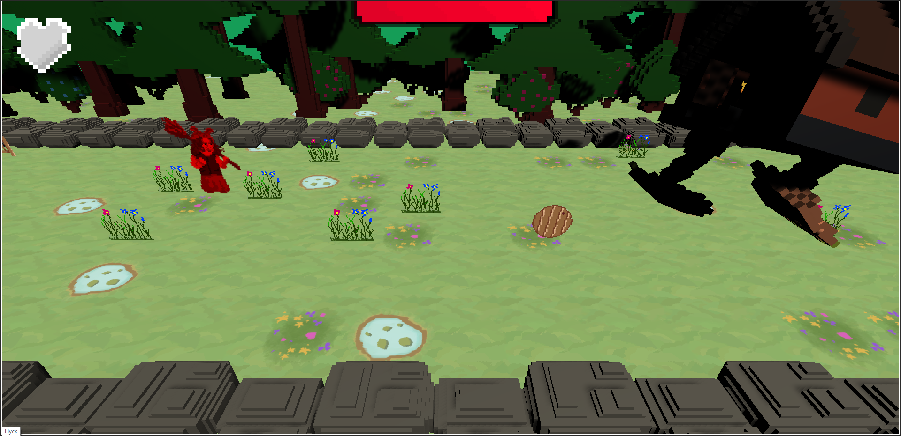
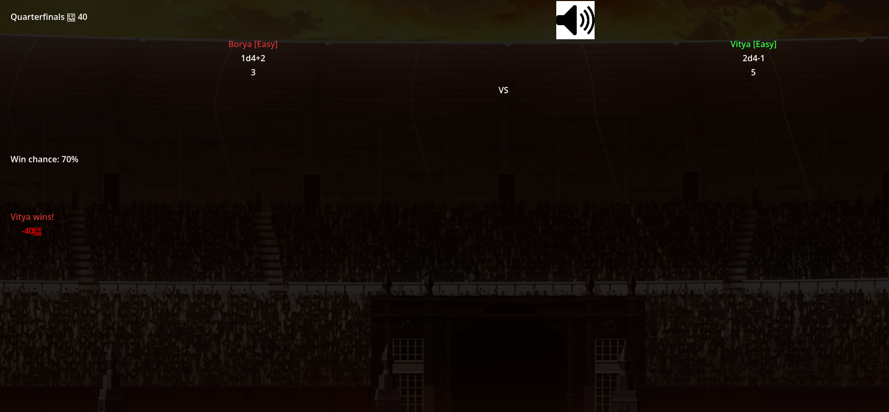

# Browser games made by prikalel (me)

## 👉https://prikalel.github.io/browser-games/👈

> Русский перевод есть во всех играх, но не во всех есть английский.

> Each game contain russian translation but some may not have english. However games are so easy to know how to play so you may end up understanding main mechanics without reading.

### Domino ladder

In the game, each turn you need to place dominoes on a simple grid so that the numbers in each column are arranged in ascending order. Play with the computer and to turn the domino - press R. as soon as a column of 4 digits is assembled, you have won. 
You will lose if there is nowhere to put any dominoes.

в игре каждый ход надо располагать доминошки на простой сетке таким образом чтобы в каждом столбце цифры располагались по возрастанию. играйте с компа, чтобы повернуть доминошку - R. как только соберётся столбик из 4 цифр - вы победили. проиграете если ни одну доминошку будет некуда поставить.

### Password miniGame

In a series of attempts of password guess, you make an assumption based on the content of the password, you can only enter the numbers 1-9, without 0. The hidden password always contains only unique numbers (without repetitions). But there is no such limitation in your attempts. If you don't make it in 30 seconds, you will be shown which password was guessed and the game if over. After each attempt, the numbers are highlighted - green if you guessed both the number and the position, yellow if your number is in the password, but it is out of place during the attempt. After a new attempt, the old one disappears, so you need to remember which attempts you made. If there is at least 1 green digit in your attempt, then in the next attempt you have to put the same digit in the same position, otherwise in the new attempt the position will turn red and 5 seconds will be taken away from the time.

В серии попыток вы делаете предположение по содержании пароля, вводить можно только цифры 1-9, без 0. Загаданный пароль всегда содержит только уникальные цифры (без повторений). Но в ваших попытках этого ограничения нет. Если вы не успели за 30 секунд вам покажут какой пароль был загадан. После попытки подсвечиваются цифры - зелёным если вы угадали и цифру и позицию, жёлтым - если ваша цифра есть в пароле, но в попытке она стоит не на своём месте. После новой попытки старая пропадает так что вам надо помнить, какие попытки вы делали.Если в вашей попытке есть хоть 1 зелёная цифра, то в следующей попытке я вам советую пытаться угадать пароль ставя на ту же позицию ту же цифру, иначе в новой попытке позиция станет красной а из времени отнимется 5 секунд.

### [ShittyMaze](https://github.com/Prikalel/ShittyMaze)

Just run through the level and shoot the enemies with an endless revolver. Find the green cube to advance to the next level. The difficulty increases with each level.

Просто бегайте по уровню и стреляйте во врагов из бесконечного револьвера. Найдите зелёный куб чтобы перейти на следующий уровень. С каждым уровнем сложность повышается.

### [Theygrow](https://github.com/Prikalel/they-grow)

Strategy-roguelike game with a selection of cards. You have 4 factions and people who can be assign between them by dragging icons. Each turn, you need to choose 2 cards, one of which will be randomly played. The goal is not to die from the fact that some parameter has become negative or all people have died out. Currently now - no english translation.

Стратегия-рогалик с выбором карт. У вас есть 4 фракции и люди, которых можно распределять между ними перетаскиванием иконок. Каждый ход нужно выбрать 2 карты одна из которых случайно разыграется. Цель - не умереть от того что какой-то параметр стал отрицательным или все люди вымерли. Сейчас в игре нет английского перевода, но есть подробный туториал по кнопке слева сверху.

### [Degustator](https://github.com/Prikalel/degustator-on-x-7)

Multiple campaigns. Each is a set of levels that must be completed without dying. Each level is a checkered board on which your character moves each turn, spending 1 unit of hunger and a certain amount of energy per turn. Energy and hunger are the player's parameters replenished by eating items, they are reset when moving to a new level, which cannot be said about coins - coins are saved between levels, but you start each campaign with 0 money. The player's choice is to choose a method of movement that will determine by tossing a die how many squares your character moves, choosing a route and choosing what to eat before moving. If hunger or strength drops to 0, you will lose. Inventory auto-sells all items on level end and you can buy something in a shop before moving to the next level.

Несколько кампаний. Каждая - это набор уровней, которые надо пройти не умирая. Каждый уровень представляет собой клетчатую доску по которой перемещается ваш персонаж каждый ход, тратя на ход 1 единицу голода и некоторое кол-во энергии. Энергия и голод - это параметры игрока пополняемые через поедание предметов, они сбрасываются при переходе на новый уровень, чего не скажешь о монетах - монеты между уровнями сохраняются, но каждую кампанию вы начинаете с 0 денег. Выбор игрока состоит в том чтобы: выбрать способ перемещения который определит подбросом кубика на сколько клеток двигается ваш персонаж, выбор маршрута и выбор что съесть перед движением. Если упали голод или сила в 0 - вы проиграете. Инвентарь автоматически продаётся в конце уровня и вам позволяют выбрать, что купить в магазине прежде, чем переходить к следующему уровню.

### [AangLegend](https://github.com/Prikalel/AangLegend)

This is a strategic card game where you control the balance of four nations: the Fire Nation, the Water Tribe, the Earth Kingdom, and the Air Nomads. Your goal is to maintain harmony between nations by making decisions that affect their resources. You don't have to read the card descriptions: just tap on the button or start swipe the card to see how the values change. The longer you last, the better.

Это стратегическая карточная игра, где вы управляете балансом четырех народов: Народа Огня, Племени Воды, Царства Земли и Кочевников Воздуха. Ваша цель - поддерживать гармонию между народами, принимая решения, которые влияют на их ресурсы. Вам необязательно читать описания карт: достаточно навестись на кнопку или начать свайпать карту, чтобы посмотреть как изменятся значения. Чем дольше ходов вы продержитесь - тем лучше.

### [TRUBA](https://github.com/Prikalel/TRUBA)

This is a very old project that I downgraded to version 3 godot. Horror with monsters - game'll even let you shoot. The end of the game is the transition to the main menu, so there are only 4 levels and 1 screamer in the game.

Это очень старый проект который я даунгрейднул до 3 версии годота. Хоррор с монстриками - вам даже дадут пострелять. Концовка игры - это переход в главное меню, таким образом всего в игре 4 уровня и 1 скример. На первом уровне надо разбить ящики сковородкой.

### Baba Yaga

A quirky action game where Baba Yaga returns to her cozy hut — but something is off. Dodge obstacles and knock incoming objects back to stop the hut. Controls: WASD move, Space - to hit an object flying at you. The hut has an HP bar - hit the objects so that they fly into the hut and so it takes damage. Dodge the pillows - it's pointless to beat them off, they don't cause damage to the hut, but they do to your character! Eat fried eggs and mushrooms to heal up, you have 3 hearts. Have you won? Take a screenshot and share it with your friends!

Нелепая экшен-игра, в которой Баба-яга возвращается в свою уютную избушку, но есть один нюанс. Уклоняйтесь от препятствий и отбивайте летящие предметы, чтобы остановить избу. Управление: WASD перемещение, Space - отбить летящий в вас предмет. У избы есть ХП бар - отбивайте предметы чтобы они летели в избу и так она получает урон. Уклоняйтесь от подушек - их бессмысленно отбивать, урон избе они не наносят, зато вашему персонажу - ещё как! Кушайте яишницу и грибы чтобы восполнить своё хп, у вас 3 сердечка. Победили? Скриньте и делитесь с друзьями!

### [Rooster fight](https://github.com/Prikalel/RoosterFight2)

Bet game where you select what roosters go to competition and can make bets.

Игра в которой вы можете выбирать каких петухов отправить на турнир а также делать ставки какой петух победит. Победа определяется броском кубиков а кубики и их кол-во зависят от петуха. Петухов можно покупать
и продавать, у каждого есть уровень.
