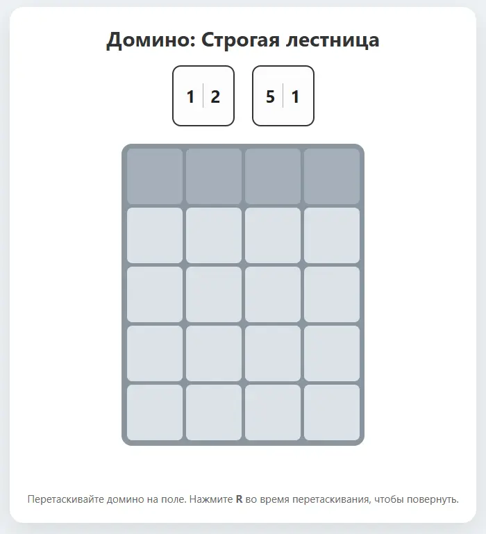
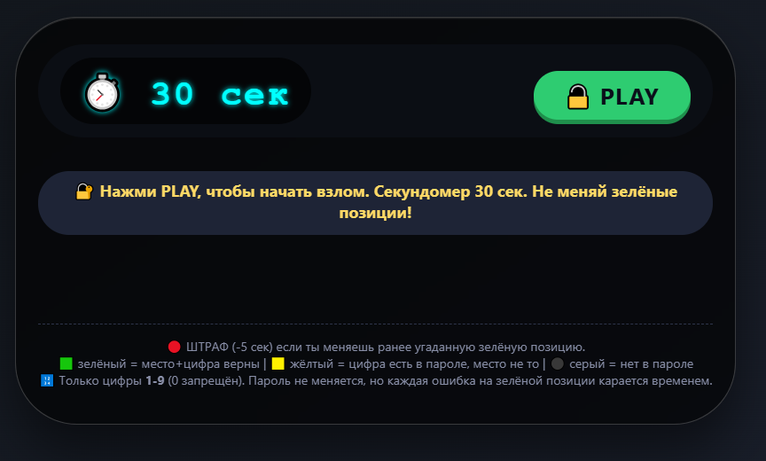
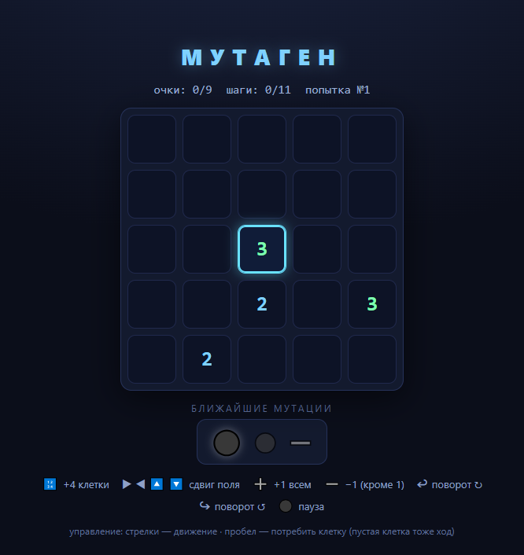
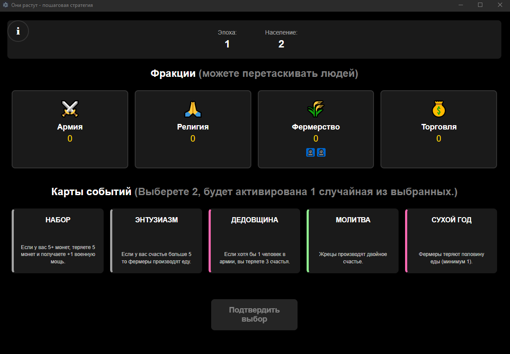
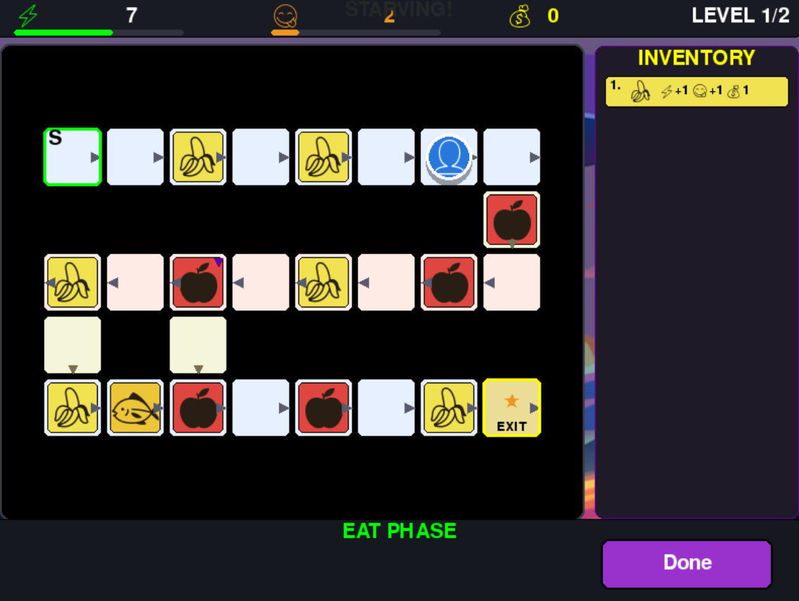
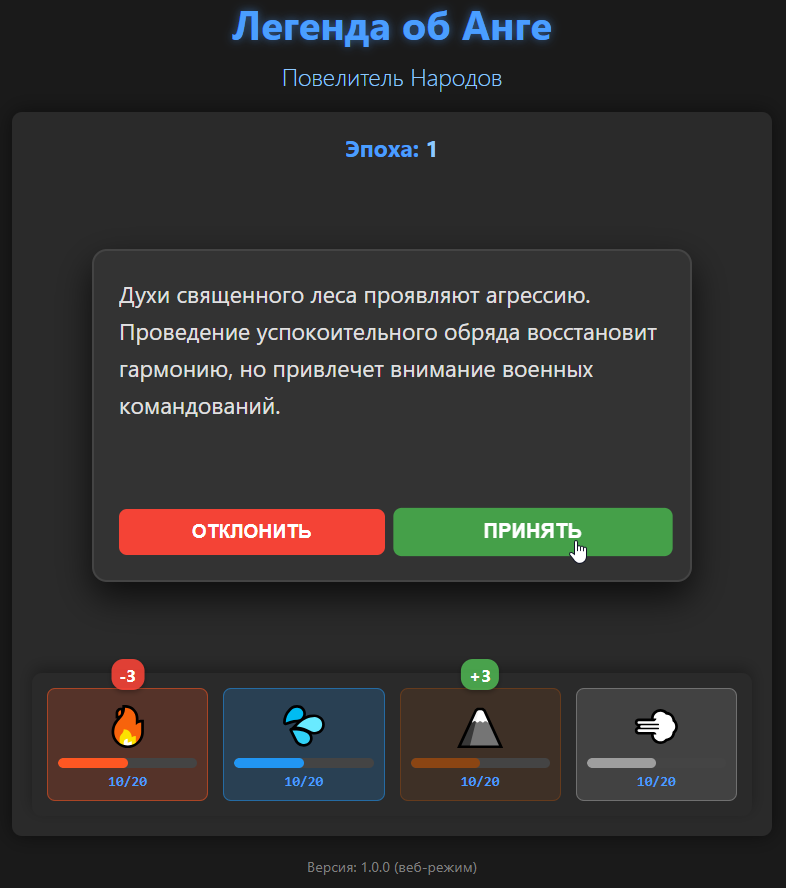
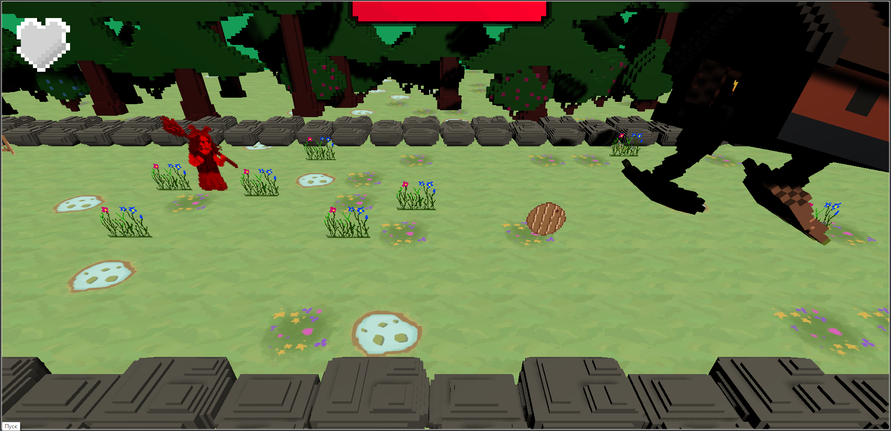
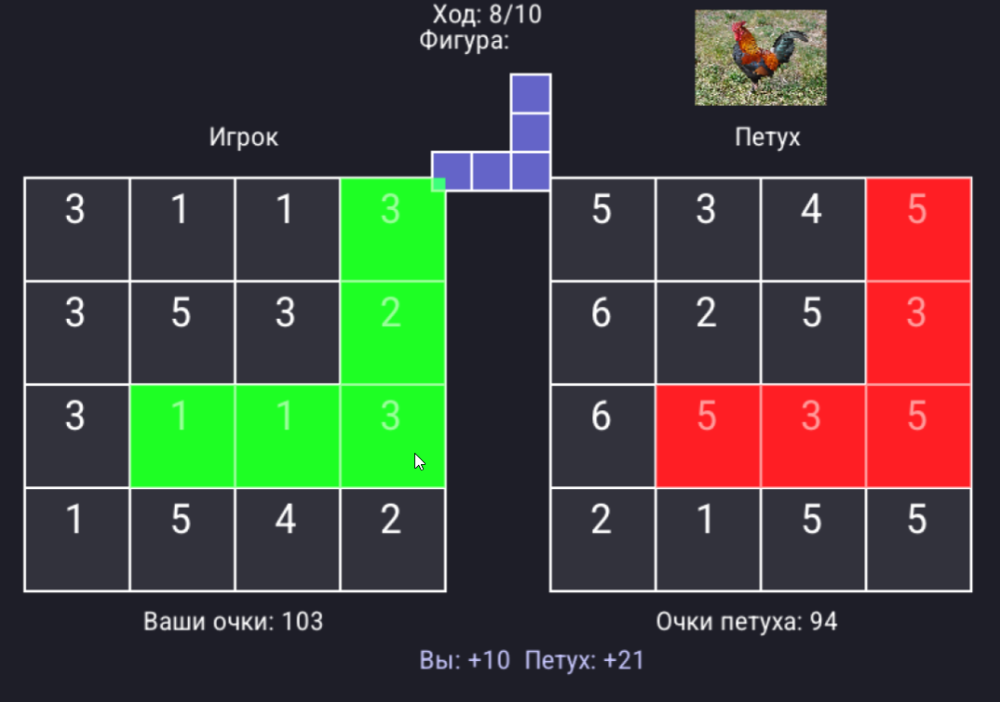

# Browser games (Vuplex edition)

> Each game contain russian translation but some may not have english. However games are so easy to know how to play so you may end up understanding main mechanics without reading.

### Domino ladder

In the game, each turn you need to place dominoes on a simple grid so that the numbers in each column are arranged in ascending order. Play with the computer and to turn the domino - press R. as soon as a column of 4 digits is assembled, you have won. 
You will lose if there is nowhere to put any dominoes.

### Password miniGame

In a series of attempts of password guess, you make an assumption based on the content of the password, you can only enter the numbers 1-9, without 0. The hidden password always contains only unique numbers (without repetitions). But there is no such limitation in your attempts. If you don't make it in 30 seconds, you will be shown which password was guessed and the game if over. After each attempt, the numbers are highlighted - green if you guessed both the number and the position, yellow if your number is in the password, but it is out of place during the attempt. After a new attempt, the old one disappears, so you need to remember which attempts you made. If there is at least 1 green digit in your attempt, then in the next attempt you have to put the same digit in the same position, otherwise in the new attempt the position will turn red and 5 seconds will be taken away from the time.

### Mutagen

A turn-based hardcore puzzle game where you need to plan the optimal route for devouring cells based on a short forecast. A victory is counted only when the most effective route is played. Simple controls - space bar to consume cells and get points, arrow keys on the keyboard to move. The game can be both complex and simple - it depends on how lucky you are with the number of mutations of the playing field. The more cells move, the harder it is to win.

### Theygrow

Strategy-roguelike game with a selection of cards. You have 4 factions and people who can be assign between them by dragging icons. Each turn, you need to choose 2 cards, one of which will be randomly played. The goal is not to die from the fact that some parameter has become negative or all people have died out. Currently now - no english translation.

### Degustator

Multiple campaigns. Each is a set of levels that must be completed without dying. Each level is a checkered board on which your character moves each turn, spending 1 unit of hunger and a certain amount of energy per turn. Energy and hunger are the player's parameters replenished by eating items, they are reset when moving to a new level, which cannot be said about coins - coins are saved between levels, but you start each campaign with 0 money. The player's choice is to choose a method of movement that will determine by tossing a die how many squares your character moves, choosing a route and choosing what to eat before moving. If hunger or strength drops to 0, you will lose. Inventory auto-sells all items on level end and you can buy something in a shop before moving to the next level.

### AangLegend

This is a strategic card game where you control the balance of four nations: the Fire Nation, the Water Tribe, the Earth Kingdom, and the Air Nomads. Your goal is to maintain harmony between nations by making decisions that affect their resources. You don't have to read the card descriptions: just tap on the button or start swipe the card to see how the values change. The longer you last, the better.

### Baba Yaga

A quirky action game where Baba Yaga returns to her cozy hut — but something is off. Dodge obstacles and knock incoming objects back to stop the hut. Controls: WASD move, Space - to hit an object flying at you. The hut has an HP bar - hit the objects so that they fly into the hut and so it takes damage. Dodge the pillows - it's pointless to beat them off, they don't cause damage to the hut, but they do to your character! Eat fried eggs and mushrooms to heal up, you have 3 hearts. Have you won? Take a screenshot and share it with your friends!

### Rooster fight

In this turn-based game, you need to place a piece on a 4x4 field each turn. The rooster will stand up to you. And as soon as the figure is positioned, it will give you points according to the values on the cells that it covers. The rooster has its own field, but it gets points according to where you place the piece. Before you click on the field, look at the bottom where it says how many points you and the rooster will get. You have 10 moves. If you get more points by the end of the game, you win!

