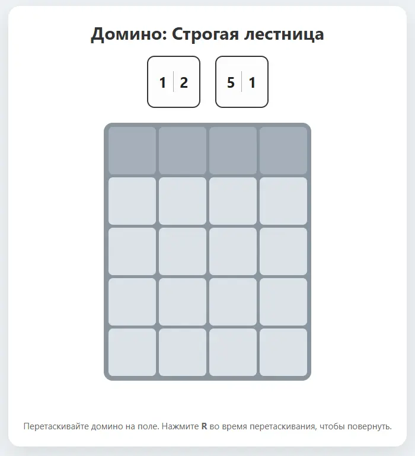
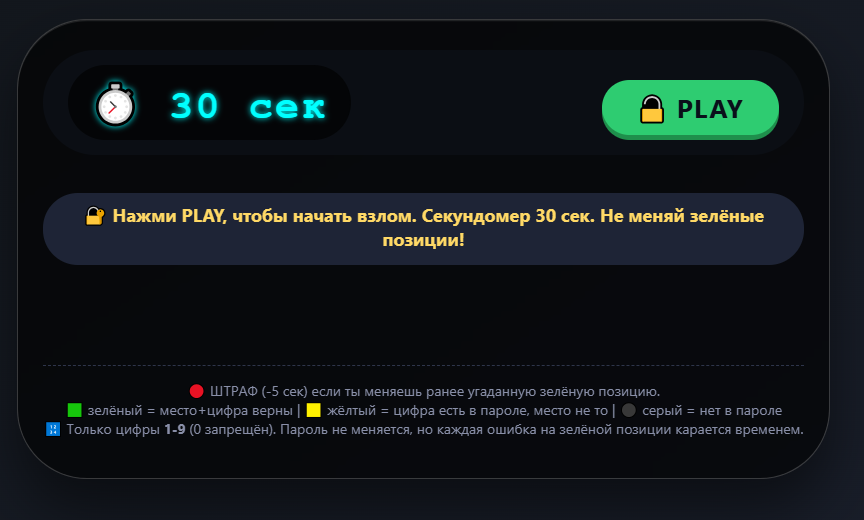
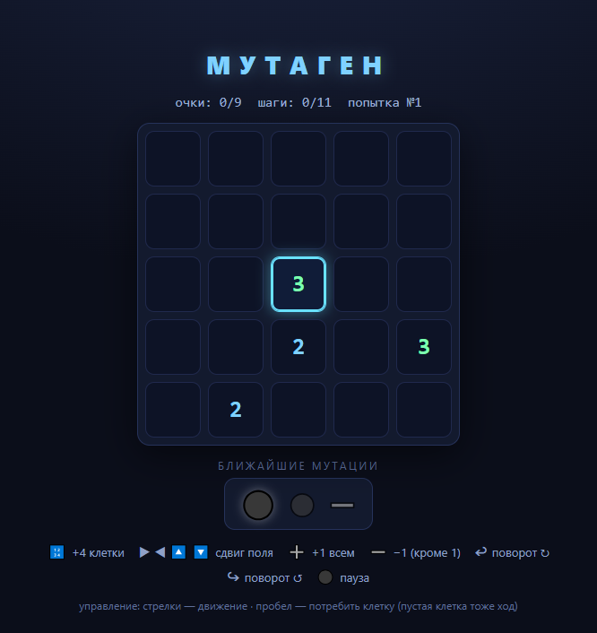
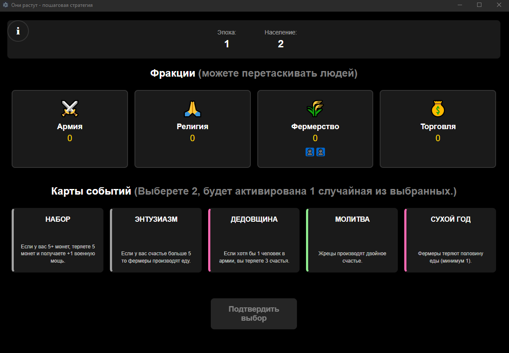
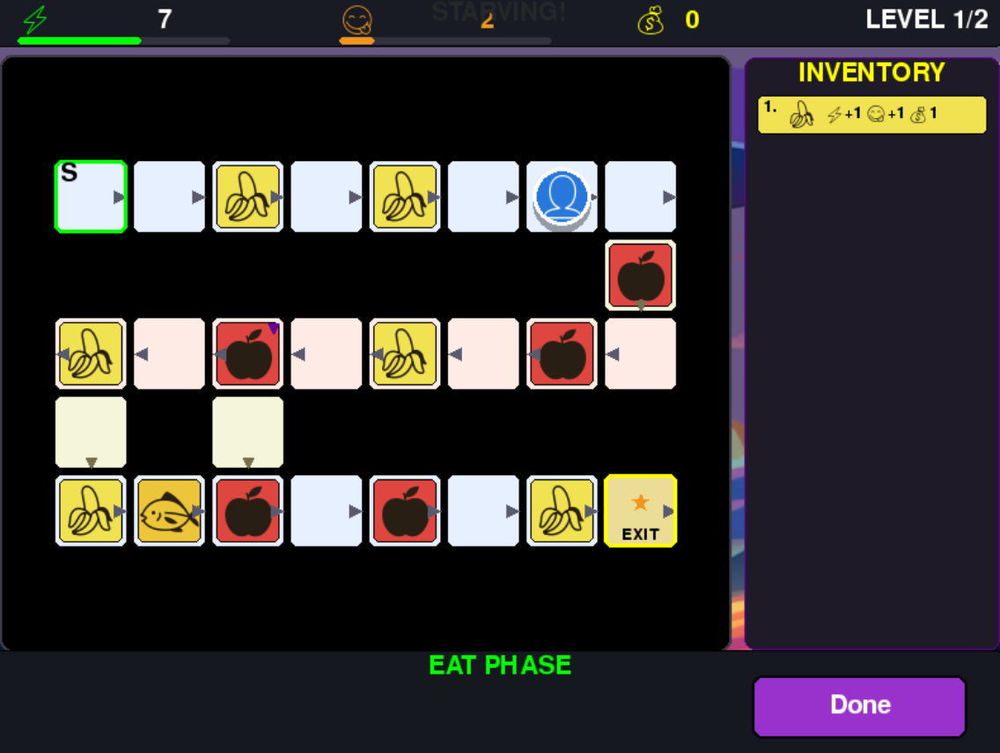
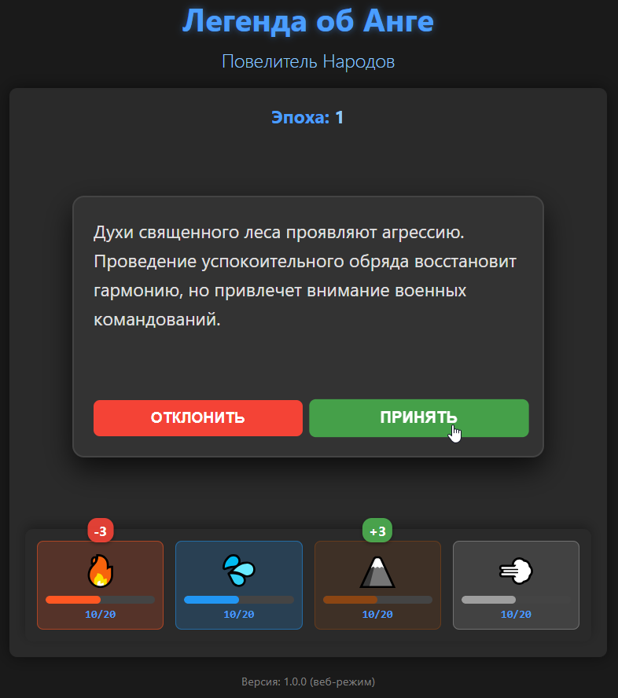
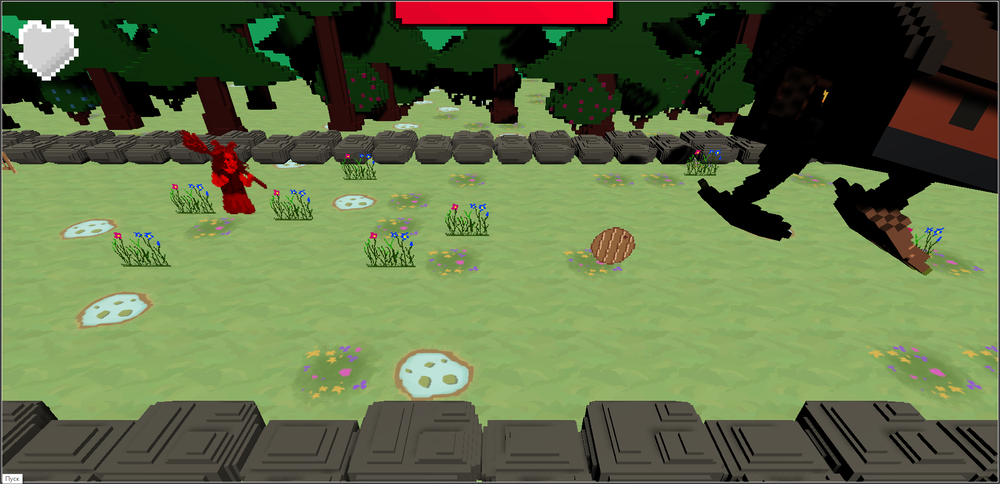
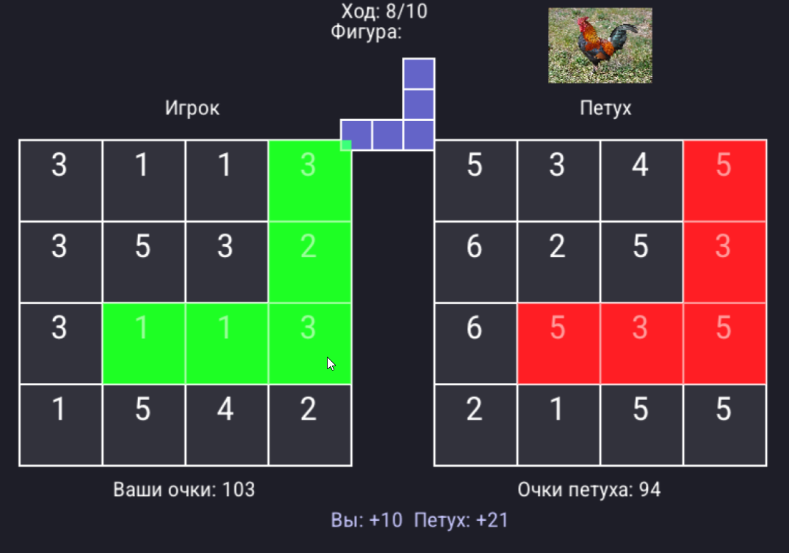

# Мини-игры (Vuplex edition)

> Русский перевод есть во всех играх, но не во всех есть английский.

### Domino ladder

в игре каждый ход надо располагать доминошки на простой сетке таким образом чтобы в каждом столбце цифры располагались по возрастанию. играйте с компа, чтобы повернуть доминошку - R. как только соберётся столбик из 4 цифр - вы победили. проиграете если ни одну доминошку будет некуда поставить.

### Password miniGame

В серии попыток вы делаете предположение по содержании пароля, вводить можно только цифры 1-9, без 0. Загаданный пароль всегда содержит только уникальные цифры (без повторений). Но в ваших попытках этого ограничения нет. Если вы не успели за 30 секунд вам покажут какой пароль был загадан. После попытки подсвечиваются цифры - зелёным если вы угадали и цифру и позицию, жёлтым - если ваша цифра есть в пароле, но в попытке она стоит не на своём месте. После новой попытки старая пропадает так что вам надо помнить, какие попытки вы делали.Если в вашей попытке есть хоть 1 зелёная цифра, то в следующей попытке я вам советую пытаться угадать пароль ставя на ту же позицию ту же цифру, иначе в новой попытке позиция станет красной а из времени отнимется 5 секунд.

### Mutagen

Пошаговая хардорная головоломка, где на основе короткого прогноза надо спланировать оптимальный маршрут пожирания клеток. Победа засчитывается только при воспроизведении наиболее эффективного маршрута. Простое управление - пробел для потребления клетки и получения очков, стрелки на клавиатуре для перемещения. Игра может быть как сложной так и простой - зависит от того как повезёт с кол-вом мутаций игрового поля. Чем больше перемещений клеток тем сложнее победить. Значок кружка означает что мутации не будет.

### Theygrow

Стратегия-рогалик с выбором карт. У вас есть 4 фракции и люди, которых можно распределять между ними перетаскиванием иконок. Каждый ход нужно выбрать 2 карты одна из которых случайно разыграется. Цель - не умереть от того что какой-то параметр стал отрицательным или все люди вымерли. Сейчас в игре нет английского перевода, но есть подробный туториал по кнопке слева сверху.

### Degustator

Несколько кампаний. Каждая - это набор уровней, которые надо пройти не умирая. Каждый уровень представляет собой клетчатую доску по которой перемещается ваш персонаж каждый ход, тратя на ход 1 единицу голода и некоторое кол-во энергии. Энергия и голод - это параметры игрока пополняемые через поедание предметов, они сбрасываются при переходе на новый уровень, чего не скажешь о монетах - монеты между уровнями сохраняются, но каждую кампанию вы начинаете с 0 денег. Выбор игрока состоит в том чтобы: выбрать способ перемещения который определит подбросом кубика на сколько клеток двигается ваш персонаж, выбор маршрута и выбор что съесть перед движением. Если упали голод или сила в 0 - вы проиграете. Инвентарь автоматически продаётся в конце уровня и вам позволяют выбрать, что купить в магазине прежде, чем переходить к следующему уровню.

### AangLegend

Это стратегическая карточная игра, где вы управляете балансом четырех народов: Народа Огня, Племени Воды, Царства Земли и Кочевников Воздуха. Ваша цель - поддерживать гармонию между народами, принимая решения, которые влияют на их ресурсы. Вам необязательно читать описания карт: достаточно навеститься на кнопку или начать свайпать карту, чтобы посмотреть как изменятся значения. Чем дольше ходов вы продержитесь - тем лучше.

### Baba Yaga

Нелепая экшен-игра, в которой Баба-яга возвращается в свою уютную избушку, но есть один нюанс. Уклоняйтесь от препятствий и отбивайте летящие предметы, чтобы остановить избу. Управление: WASD перемещение, Space - отбить летящий в вас предмет. У избы есть ХП бар - отбивайте предметы чтобы они летели в избу и так она получает урон. Уклоняйтесь от подушек - их бессмысленно отбивать, урон избе они не наносят, зато вашему персонажу - ещё как! Кушайте яишницу и грибы чтобы восполнить своё хп, у вас 3 сердечка. Победили? Скриньте и делитесь с друзьями!

### Rooster fight

В этой пошаговой игре вам надо каждый ход располагать какую-то фигуру на 4на4 поле. Петух будет вам противостоять. И фигура как только будет расположена даст вам очки в соответствии с значениями на клетках которые она покрывает. У петуха - своё поле, но очки он получает в соответствии с тем где вы располагаете фигуру. Прежде чем кликнуть на поле посмотрите внизу, где будет написано сколько очков получите вы и петух. У вас 10 ходов. Если к концу игры у вас получится больше очков - вы победили!
